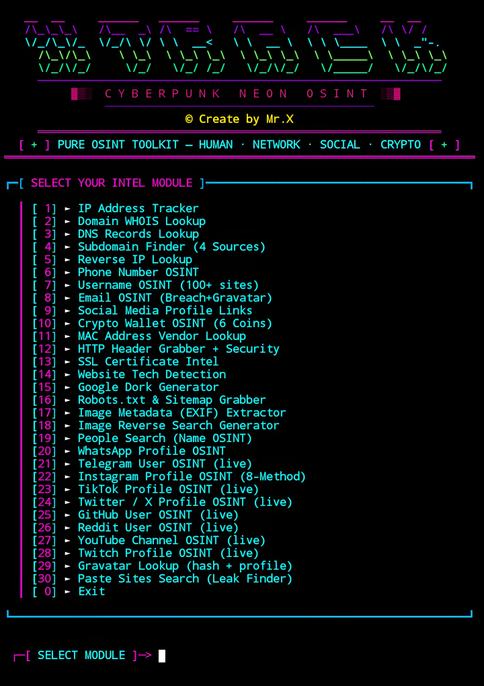

# Xtrack.py — PURE OSINT TOOLKIT


<p align="center">
  <strong>Pure OSINT Multi-Tool — Cyberpunk Neon Overpower Edition</strong><br>
  <em>"Stay ghost. Stay untraceable. Leave no trace." – Mr.X</em>
</p>

## Introduction
**Xtrack.py — PURE OSINT TOOLS (CYBERPUNK NEON OVERPOWER EDITION)** is a terminal-based Open Source Intelligence (OSINT) framework built for human, network, social, and crypto reconnaissance. Unlike pentest frameworks, this toolkit is **strictly OSINT** — no scanning, no exploitation, no intrusive activity. It aggregates 30 specialized modules covering IP geolocation, WHOIS, DNS, subdomain enumeration, phone/email/username intelligence, social media profiling (Instagram 8-method engine, TikTok, Twitter/X, YouTube, Reddit, GitHub, Twitch, Telegram), EXIF metadata extraction, Google dorking, and more. Every module returns structured, easy-to-read output wrapped in a **24-bit true-color neon cyberpunk UI** with dynamic terminal-width support.

**Important:** This tool is strictly intended for educational and authorized security research use only.

## Features
- **30 OSINT Modules** in one unified cyberpunk UI.
- **Pure OSINT** — no port scanning, no exploitation, no intrusive probing.
- **IP Intelligence**: GeoIP, RDAP/RIR, BGP/ASN, DNSBL blacklist check, reverse DNS, threat profiling, external intel links.
- **Domain Recon**: WHOIS (with RDAP fallback), full DNS record lookup (A, AAAA, MX, NS, TXT, SOA, CAA, DNSSEC, TLSA, HTTPS/SVCB, etc.), email security records (SPF/DKIM/DMARC).
- **Subdomain Finder**: Multi-source aggregation (crt.sh, HackerTarget, AlienVault OTX, urlscan.io).
- **Reverse IP Lookup**: Enumerate domains hosted on a given IP with TLD statistics.
- **Phone OSINT**: Carrier, geolocation, timezone, number type, E.164/national/RFC3966 formats, plus Truecaller / WhatsApp / Telegram / Viber lookup links.
- **Username Enumeration**: 100+ platforms scanned in parallel with confirmed-profile summary.
- **Email OSINT**: Format validation, MX/SPF/DMARC check, Gravatar hash lookup, xposedornot & emailrep breach/reputation check, guessed social profiles.
- **Crypto Wallet OSINT**: BTC, ETH, LTC, DOGE, BCH, DASH — balances, TX counts, tokens (ETH), explorer links.
- **Social Profile OSINT (live scrapers)**:
  - **Instagram** — 8-method extraction engine (i.instagram.com API, session+CSRF, OG meta, Picuki, Imginn, Gramhir, Pixwox, Inflact).
  - **TikTok** — universal data + oEmbed + Urlebird + OG fallback, recent videos with stats.
  - **Twitter / X** — syndication API + Nitter fallbacks + OG meta.
  - **Reddit** — .json API with proper UA, posts + comments + karma breakdown.
  - **YouTube** — ytInitialData parser + oEmbed fallback.
  - **Twitch** — decapi.me + OG scrape.
  - **GitHub** — full API: profile, top repos, languages, orgs, recent activity.
  - **Telegram** — live preview scraper (display name, bio, members, avatar CDN).
  - **WhatsApp** — profile preview scrape + direct chat/QR links.
- **MAC Address Vendor Lookup** with OUI parsing (multicast/local/admin flags).
- **HTTP Header Grabber** with security header analysis (HSTS, CSP, COOP, CORP, etc.).
- **SSL Certificate Intel**: TLS version, cipher, subject/issuer, SANs, SHA-256/SHA-1/MD5 fingerprints, days-to-expiry.
- **Website Tech Detection**: CMS, JS frameworks, analytics, CDN, hosting, security headers, web server — 60+ signatures.
- **Google Dork Generator**: 55+ ready-to-run dorks per target.
- **Robots.txt / Sitemap / .well-known Grabber**: 15 common sensitive paths.
- **Image Metadata (EXIF) Extractor**: hash, device fingerprint, GPS coordinates with Google Maps / OSM links.
- **Image Reverse Search Generator**: Google Lens, Yandex, TinEye, SauceNAO, PimEyes, FaceCheck.id and more.
- **People Search (Name OSINT)**: 14 people-finder sites + social searches + deep dorks.
- **Paste Sites Search**: pastebin, gist, ghostbin, and 10+ leak aggregators.
- **Gravatar Lookup**: MD5/SHA-256 hash + profile JSON + linked accounts.
- **Cyberpunk Neon UI**: 24-bit true-color palette, boot sequence, glitch text, boot-skull ASCII art, auto-wrapping to terminal width, exit sequence.
- **Cross-platform**: Linux, Windows, Termux (Android) — Python 3, no root required.

## Installation
```bash
$ pkg update -y && pkg upgrade -y
$ pkg install git python -y
$ git clone https://github.com/Whomrx666/Xtrack.git
$ cd Xtrack
$ python3 install.py
```

> **Note:** `phonenumbers` is required for Module 6 (Phone OSINT) and `Pillow` for Module 17 (EXIF Extractor). All other modules rely on `requests` (stdlib-adjacent) and Python 3.8+.

## Run manually
```
$ python3 Xtrack.py
```

## Modules Overview
| Option | Description |
|--------|-------------|
| 1  | IP Address Tracker (GeoIP + RDAP + BGP + DNSBL) |
| 2  | Domain WHOIS Lookup (with RDAP fallback) |
| 3  | DNS Records Lookup (19 record types + DMARC/DKIM) |
| 4  | Subdomain Finder (4 Sources) |
| 5  | Reverse IP Lookup |
| 6  | Phone Number OSINT |
| 7  | Username OSINT (100+ sites) |
| 8  | Email OSINT (Breach + Gravatar) |
| 9  | Social Media Profile Links |
| 10 | Crypto Wallet OSINT (6 Coins) |
| 11 | MAC Address Vendor Lookup |
| 12 | HTTP Header Grabber + Security Analysis |
| 13 | SSL Certificate Intel |
| 14 | Website Tech Detection |
| 15 | Google Dork Generator |
| 16 | Robots.txt & Sitemap Grabber |
| 17 | Image Metadata (EXIF) Extractor |
| 18 | Image Reverse Search Generator |
| 19 | People Search (Name OSINT) |
| 20 | WhatsApp Profile OSINT |
| 21 | Telegram User OSINT (live) |
| 22 | Instagram Profile OSINT (8-Method) |
| 23 | TikTok Profile OSINT (live) |
| 24 | Twitter / X Profile OSINT (live) |
| 25 | GitHub User OSINT (live) |
| 26 | Reddit User OSINT (live) |
| 27 | YouTube Channel OSINT (live) |
| 28 | Twitch Profile OSINT (live) |
| 29 | Gravatar Lookup (hash + profile) |
| 30 | Paste Sites Search (Leak Finder) |
| 0  | Exit |

## How It Works
- **Boot Sequence**: Runs a neon-skull ASCII splash, kernel-style boot log, and progress bar before entering the main menu.
- **Modular Dispatch**: Each numbered option is a self-contained function wrapped by an `@is_option` decorator that re-renders the banner before execution.
- **Live Scraping**: Social modules (Instagram, TikTok, Twitter/X, YouTube, Reddit, Telegram, Twitch) use real HTTP requests against public endpoints with realistic browser headers and multi-source fallbacks so the tool keeps working even when one source changes its API.
- **Utility Layer**: `kv()`, `kv_item()`, `kv_bullet()` and `wrap_text()` all auto-wrap to the current terminal width, keeping output readable on anything from Termux to a 4K terminal.
- **Data Enrichment**: Aggregated data is combined from multiple providers (ipwho.is, ip-api, rdap.org, bgpview, dns.google, cloudflare-dns, hackertarget, alienvault, urlscan, xposedornot, emailrep, decapi.me, i.instagram.com, tiktok, youtube, reddit .json, github api) — no API keys required.
- **External Link Generation**: Every module prints clickable deep-links to Shodan, Censys, VirusTotal, AbuseIPDB, Truecaller, HaveIBeenPwned, Google Lens, PimEyes and more, so manual verification is one click away.
- **Exit Sequence**: A neon farewell splash with shutdown countdown before returning to the shell.

## Disclaimer
This tool is made for **educational and authorized security research purposes only**. Unauthorized scraping, accessing, or exploiting devices/accounts you do not own or have explicit consent for is illegal and unethical. The author is **not responsible** for any misuse or damages resulting from this tool. Always respect platform terms of service, local laws, and privacy of individuals.

### Original Author
<a href="https://github.com/Whomrx666"></a>

### <<< If you copy, then give me the credits >>>

## CONNECT WITH ME :

[](https://whomrx.pages.dev) <br>
[](https://whomrxhackers.blogspot.com) <br>
[](https://twitter.com/whomrx666) <br>
[](https://wa.me/6285926601133?text=Halo%2C%20Mr.X) <br>
[](https://www.facebook.com/whomrx.666) <br>
[](https://t.me/Whomr_X) <br>
[](mailto:whomrx666@gmail.com) <br>
[](https://www.tiktok.com/@whomr.x)

**If you want to donate, click on the button**
<a href="https://saweria.co/whomrx"></a>

---

<p align="left">
  
</p>